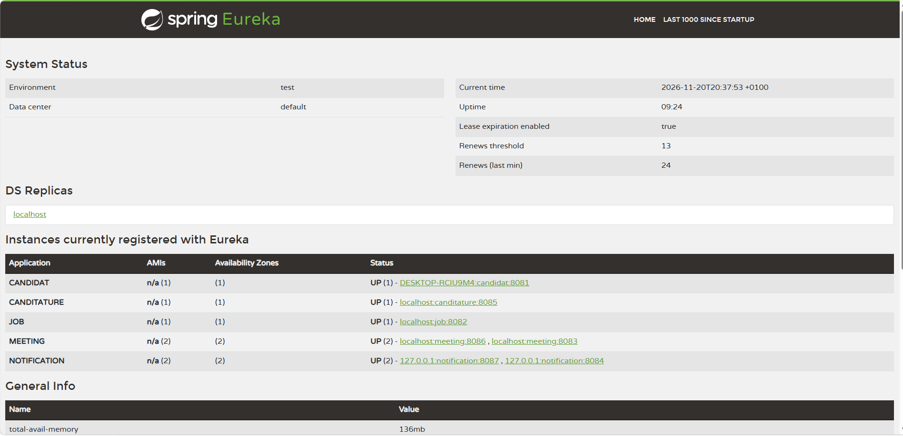

# Eureka Server & Microservices

## 1. Project Description

This project demonstrates the implementation of a microservices architecture using **Netflix Eureka Server** for service registration and discovery.

The objective is to register multiple microservices as Eureka clients and manage their instances through a centralized Eureka dashboard.

## 2. Project Architecture

The architecture consists of one Eureka Server and four microservices.

| Component | Technology | Port(s) | Role |
|---|---|---|---|
| Eureka Server | Spring Boot / Netflix Eureka | 8761 | Service registration and discovery |
| CANDIDAT | Spring Boot | 8081 | Candidate management |
| JOB | Spring Boot | 8082 | Job management |
| MEETING | Node.js | 8083, 8086 | Meeting management |
| NOTIFICATION | Python / FastAPI | 8084, 8087 | Notification management |

## 3. Eureka Dashboard

The Eureka dashboard provides an overview of all registered microservices and their running instances.

All four services (CANDIDAT, JOB, MEETING and NOTIFICATION) are expected to be registered and visible simultaneously.

### Dashboard Screenshot


## 4. Multiple Instances

To demonstrate service scalability and availability, multiple instances are configured:

- MEETING: ports 8083 and 8086.
- NOTIFICATION: ports 8084 and 8087.

Each instance registers independently with the Eureka Server.

## 5. Technologies Used

- Java
- Spring Boot
- Netflix Eureka Server
- Node.js
- Python
- FastAPI
- MySQL
- Git
- GitHub

## 6. Project Structure

```text
backend/
│
├── eureka-server/
│
└── microservices/
    ├── candidat/
    ├── job/
    ├── meeting/
    └── notification/
    
screenshots/
└── eureka-dashboard.png

README.md
```

*Note: Adapt the folder names above if they differ from your actual project structure.*

## 8. How to Run the Project

1. Start the Eureka Server on port 8761.
2. Start the CANDIDAT microservice on port 8081.
3. Start the JOB microservice on port 8082.
4. Start two MEETING instances on ports 8083 and 8086.
5. Start two NOTIFICATION instances on ports 8084 and 8087.
6. Open the Eureka dashboard:

   http://localhost:8761

7. Verify that all four microservices and their instances are registered.

## 9. GitHub Repository

Repository: [Insert your GitHub repository URL]

